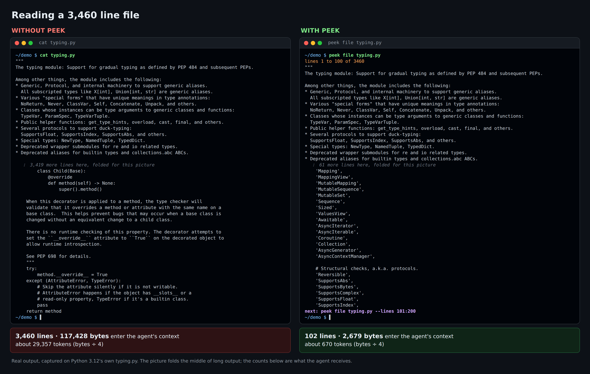
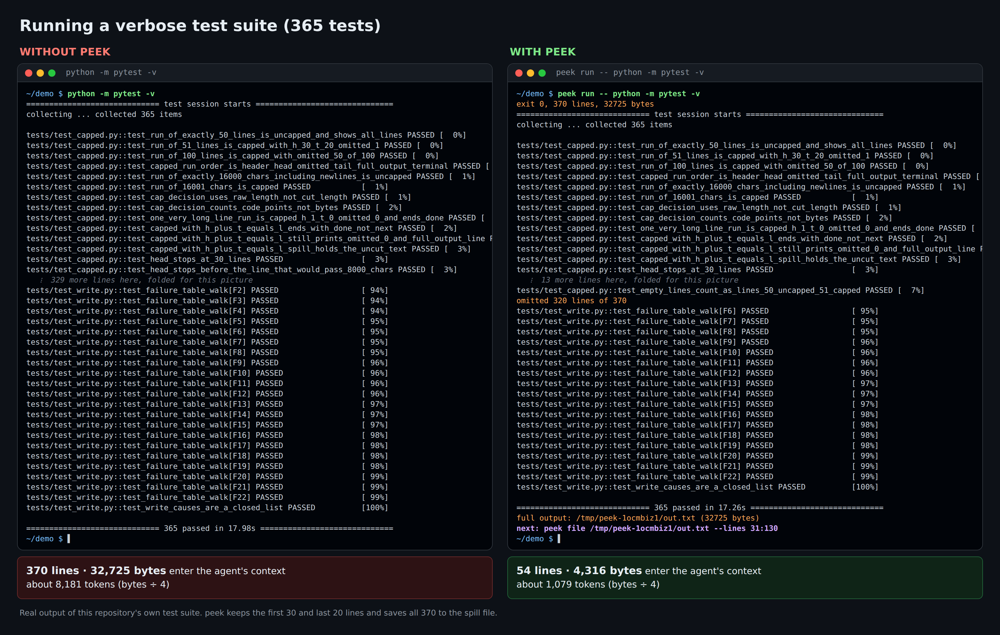
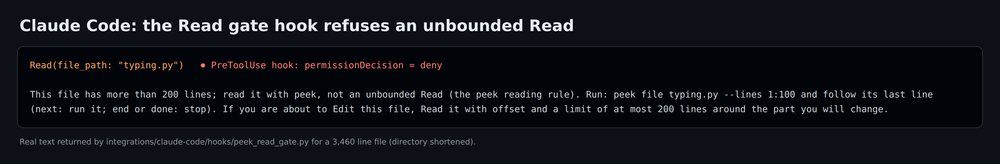

<p align="center">
  
</p>

<p align="center">
  <a href="https://github.com/mdalexandre/peek/actions/workflows/test.yml"></a>
  
  
  <a href="LICENSE"></a>
</p>

# peek

### A 100,000-line log. Your agent sees it 100 lines at a time.

Behind every coding agent is more text than it can hold: a monorepo, a build log, a test run that scrolls for minutes. peek is a window onto it. Each call shows at most 100 lines and, while more remains, names the next window. Everything else stays where it is, whole and unread, until the agent asks for it.

**Bounded file windows and command runs for AI coding agents.** peek is a small command line tool that sits between an AI coding agent (Claude Code, Codex CLI, or any agent with a shell) and the files and commands it touches. A file window holds at most 100 lines; a long command run shows its first 30 and last 20 lines and saves the rest. The last line tells the agent exactly what to run next, or that it has reached the end, so it can still read everything, one bounded step at a time, but no single result can flood its context window.

- [The problem](#the-problem)
- [What peek does, side by side](#what-peek-does-side-by-side)
- [Install](#install)
- [The four commands](#the-four-commands)
- [The output contract](#the-output-contract)
- [Limits](#limits)
- [Agent integrations](#agent-integrations)
- [Design choices](#design-choices)
- [Development](#development)

## The problem

An agent reads by putting text into its context window. Everything it reads stays there, costs tokens on every following turn, and pushes out what it read earlier. Two ordinary actions do most of the damage:

1. **Reading a whole file to find one part.** `cat` on a 3,000 line file puts all 3,000 lines in context, even when the agent needed one function.
2. **Running a command with long output.** A verbose test run, a build log or a big `grep` arrives in full, and the one line that matters (the failure, the summary) is buried in the middle or lost to truncation.

Agents also cannot know how long a file is until they have read it, so rules like "use a line range for big files" fail in practice: the agent finds out the file was big only after it has already paid for it.

## What peek does, side by side

All three pictures below are rendered from real, unedited output captured on the same machine; only the middle of long output is folded so it fits on screen. The red and green boxes give the full size of what each command actually returns to the agent.

### Reading a file

`cat` returns all 3,460 lines of Python's `typing.py`. `peek file` returns a window of 100 lines, starting with the file's total length, and ends with the exact command for the next window.

<p align="center"></p>

### Running a command

A verbose run of this repository's own 365 tests prints 370 lines. Through `peek run`, the agent sees the first 30 lines, a count of what was left out, and the last 20 lines (where pytest prints its summary). Nothing is lost: all 370 lines are saved to a spill file, and the last line says how to read on.

<p align="center"></p>

### The numbers

| Task | Without peek | With peek | Reduction |
|---|---|---|---|
| Read `typing.py` (3,460 lines) | 117,428 bytes, about 29,400 tokens | 2,679 bytes, about 670 tokens | 97.7% |
| `pytest -v`, 365 tests | 32,725 bytes, about 8,200 tokens | 4,316 bytes, about 1,080 tokens | 86.8% |

Tokens are estimated as bytes ÷ 4. The saving grows with the size of the file or the output, because peek's ceiling is fixed.

### Steering the agent at the moment it reads

The [Claude Code integration](integrations/claude-code/README.md) includes a hook that refuses an unbounded `Read` of a file over 200 lines and hands the agent the exact peek command instead. This is the real refusal text:

<p align="center"></p>

## Install

peek needs Python 3.11 or newer and nothing else: standard library only, no network access.

```
pipx install git+https://github.com/mdalexandre/peek
```

or with pip:

```
pip install git+https://github.com/mdalexandre/peek
```

or run it straight from a clone, without installing:

```
git clone https://github.com/mdalexandre/peek
./peek/bin/peek file README.md
```

## The four commands

```
peek file PATH [--lines A:B]                          # a window of at most 100 lines
peek run -- CMD [ARGS...]                             # run, cap and spill long output
peek token PATH                                       # SHA-256 of the file right now
peek write PATH --lines A:B --token TOKEN --from SRC  # replace lines A to B safely
```

### `peek file`: read a window of a file

```
$ peek file typing.py
lines 1 to 100 of 3460
"""
The typing module: Support for gradual typing as defined by PEP 484 and subsequent PEPs.
...
    'SupportsIndex',
next: peek file typing.py --lines 101:200
```

- The first line gives the window and the file's total length, so the agent learns the size on its first call.
- Without `--lines`, the window is lines 1 to 100. With `--lines A:B`, the agent jumps straight to the part it needs. A range of more than 100 lines is clipped, and the output says so.
- The last line is `next:` while lines remain, and `end: ...` on the final window:

```
$ peek file notes.txt --lines 3:5
lines 3 to 5 of 5
GAMMA
extra
delta
end: lines 3 to 5 of 5
```

- A line longer than 400 characters is cut and tagged `[cut: N chars]`, so one minified line cannot blow the budget.

### `peek run`: run a command with capped output

```
$ peek run -- python -m pytest -v
exit 0, 370 lines, 32725 bytes
============================= test session starts ==============================
collecting ... collected 365 items
... 28 more lines ...
omitted 320 lines of 370
... 19 more of the last 20 lines ...
============================= 365 passed in 17.26s =============================
full output: /tmp/peek-1ocmbiz1/out.txt (32725 bytes)
next: peek file /tmp/peek-1ocmbiz1/out.txt --lines 31:130
```

- The header gives the exit code, the line count and the byte count of the full output.
- Output of 50 lines or fewer (and under 16,000 characters) is shown whole and ends with `done`.
- Longer output shows the first 30 and last 20 lines, an `omitted` count, and the path of the spill file holding everything, byte for byte. The `next:` line continues reading from line 31 of the spill.
- stdout and stderr are merged into one stream. The command gets no stdin, so a program waiting for input ends instead of hanging the agent.
- **peek exits with the command's own exit code** (128+n when a signal kills it), so `peek run -- make test && deploy` works exactly like the bare command:

```
$ peek run -- sh -c 'echo hi; exit 4'
exit 4, 1 lines, 3 bytes
hi
done
$ echo $?
4
```

- peek starts no shell. For pipes, globs and redirects, ask for one: `peek run -- sh -c 'grep -n TODO *.py | head -50'`.

### `peek token` and `peek write`: replace a line range safely

An agent that edits a file it read a few turns ago may be working from a stale copy. `peek write` refuses to write unless the file is exactly as it was when the agent took its token.

```
$ peek token notes.txt
exit 0, 4 lines, 23 bytes
token: 927c9bb49935d22cfef1df0fd954eb8011420a9b1ec2350d65647accf201bbe9
done

$ peek write notes.txt --lines 2:3 --token 927c9bb4...01bbe9 --from /dev/stdin <<'EOF'
BETA
GAMMA
extra
EOF
lines 2 to 4 of 5
BETA
GAMMA
extra
replaced lines 2 to 3 with 3 lines
wrote 29 bytes, file now 5 lines
token: de50ec80a4b0c8bbb7c5a6b1b60c2dc860cf7f94cb60070151aac97b4a8d0b96
next: peek file notes.txt --lines 5:104
```

- The token is the SHA-256 of the file's bytes.
- The readback shows the lines just written and returns a fresh token for the next edit.
- If anything changed the file in between, nothing is written and peek exits 3:

```
$ peek write notes.txt --lines 1:1 --token 927c9bb4...01bbe9 --from /dev/stdin
exit 3, 0 lines, 0 bytes
error: stale token
done
```

The agent then takes a new token, rereads the range and writes again.

## The output contract

Every peek output follows the same shape, so an agent (or a script) can rely on it without guessing:

- **The first line** is a header: `lines A to B of N` for a file window, or `exit C, L lines, B bytes` for anything else.
- **The last line** is always one of three things:
  - `next: <command>`: more to read; run this command exactly as printed.
  - `end: ...`: a file window reached the last line.
  - `done`: nothing more to read.
- **Errors** have one fixed shape: a header with zero lines, one `error:` line, then `done`.

```
$ peek file nope.txt
exit 2, 0 lines, 0 bytes
error: no such file
done
$ peek file notes.txt --lines 9:12
exit 2, 0 lines, 0 bytes
error: range past end of file (5 lines)
done
$ peek run -- nosuchcmd
exit 127, 0 lines, 0 bytes
error: command not found
done
```

- **The grammar is strict on purpose.** Only the exact forms above are accepted. Anything else, `--help` included, prints `error: usage` and exits 2. An agent that only ever sees four fixed forms has nothing to improvise.

## Limits

| Limit | Value |
|---|---|
| Lines in one file window | 100 |
| Characters in one file window | 16,000 |
| Characters kept per line | 400, then `[cut: N chars]` |
| Command output shown in full | up to 50 lines and 16,000 characters |
| Capped command output | first 30 lines and last 20 lines |
| Spill file | full output, byte for byte, in a private temp directory (`0700`, file `0600`) |

## Agent integrations

A tool the agent never thinks to use does nothing. In our own sessions, when peek was only mentioned deep in a long instruction file, agents used it for about 1% of shell calls. The integrations pair a short, unconditional rule with a hook that acts at the moment of the read.

- **[Claude Code](integrations/claude-code/README.md)**
  - a `peek` skill that teaches paging, capped runs, spill files, pipelines, exit codes and safe edits;
  - a `CLAUDE.md` rule to paste;
  - `peek_read_gate.py`, a PreToolUse hook that refuses an unbounded `Read` of a text file over 200 lines and returns the exact `peek file` command. It allows a `Read` with a `limit` of at most 200 (Edit needs a prior Read), small files, images, PDFs, notebooks and binary files, and it fails open on any error.
- **[Codex CLI](integrations/codex/README.md)**
  - an `AGENTS.md` rule to paste;
  - `peek_read_nudge.py`, an advisory PostToolUse hook: when a shell command read a file over 200 lines with `cat`, `sed`, `head` and the like, it adds a reminder with the exact peek command. It never blocks, because a blocking hook on ordinary shell work can stall a Codex session.

Any other agent with a shell can use peek as is: put the [short usage reference](bin/USAGE.md) in its instructions.

## Design choices

**Why not just `head`, `tail` or `sed -n`?** They bound the output only when the agent already knows where to look and how long the file is. peek tells the agent the length on the first call, cuts runaway lines, caps command output it cannot predict, keeps the full output in a spill file, and always says what to run next.

**Why the `next:` line?** Paging is where agents go wrong: off by one ranges, skipped windows, rereading the same lines. The `next:` command is computed by peek and runs as printed, so walking a whole file is a loop with no arithmetic.

**Why head and tail for commands?** The start of a run says what ran and how it began; the end holds the result, the summary and usually the error. The middle is counted, saved and reachable, not dropped.

**Why exit with the wrapped command's code?** So `&&`, `||` and scripts behave exactly as they would without peek. An agent can wrap any command without changing its logic.

**Why no stdin and no shell?** A command waiting for input would hang the agent forever. Starting no shell means peek runs exactly the program it was given; pipes and globs are opt in with `sh -c`.

**Why tokens for edits?** An agent edits from its memory of the file. If the file changed since, a line range edit lands in the wrong place. A SHA-256 token turns that silent corruption into a clear `stale token` error.

## Development

```
python3 -m pytest          # 365 tests, no network
ruff check src tests integrations
python3 -m pytest integrations/claude-code/hooks/tests integrations/codex/hooks/tests
```

CI runs all three on Python 3.11, 3.12 and 3.13.

## License

[MIT](LICENSE)
